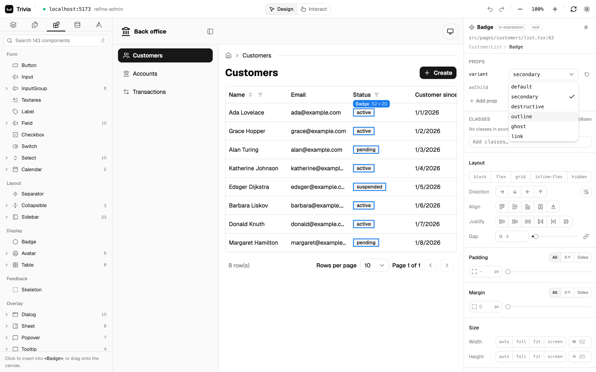
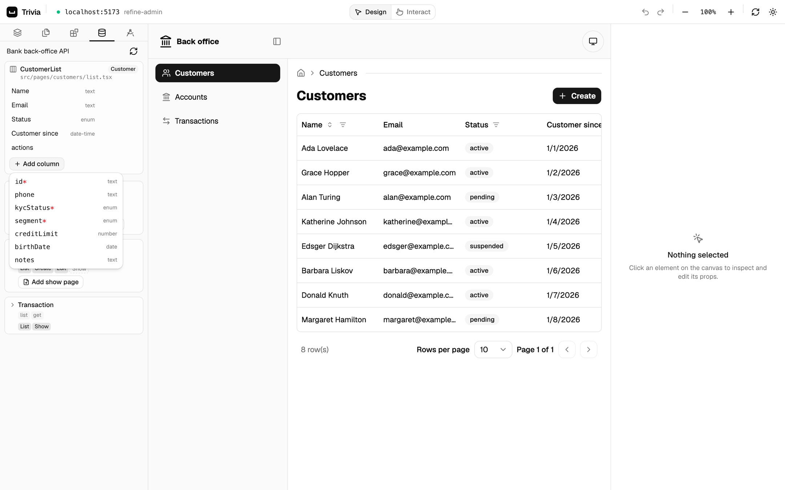

<h1 align="center">Trivia</h1>

<p align="center">
  <b>A visual editor for React that edits your real source code, byte for byte.</b>
</p>

<p align="center">
  <a href="https://github.com/kylesmile1103/trivia/actions/workflows/ci.yml"></a>
  <a href="https://github.com/kylesmile1103/trivia/actions/workflows/nightly.yml"></a>
  <a href="https://github.com/kylesmile1103/trivia/actions/workflows/codeql.yml"></a>
  <a href="https://github.com/kylesmile1103/trivia/releases"></a>
  <a href="LICENSE"></a>
  <br>
  
  
  
  
</p>

Point at an element in your running app, change it, and the change lands in your `.tsx` file as a
minimal text edit. Everything you didn't touch stays exactly as you wrote it, whitespace and
comments included. Edit from the canvas, your IDE or an AI agent: all three work on the same files.

<p align="center">
  <picture>
    <source media="(prefers-color-scheme: dark)" srcset="docs/images/designer-dark.png">
    
  </picture>
  <br>
  <sub>One click selects the Status badge, and every row lights up: they all come from line 63 of
  <code>src/pages/customers/list.tsx</code>. Picking a variant rewrites that one attribute.</sub>
</p>

> In compiler terms, *trivia* is the whitespace and comments a parse-and-print round trip throws
> away. Keeping them is the whole point.

## Why Trivia

- **Diffs you can review.** No reformatting, no generated regions, no sidecar files.
- **Edits that refuse to guess.** Each change names what it expects to find; if the file moved on,
  Trivia says so instead of editing the wrong thing. Undo is byte-exact.
- **Knows your API contract.** For Refine + shadcn apps on OpenAPI: columns, form fields, contract
  drift and new resource pages, planned from the spec and written as ordinary code.
- **Local and dev-only.** Nothing is added to your production bundle. No account, no telemetry.

<p align="center">
  <picture>
    <source media="(prefers-color-scheme: dark)" srcset="docs/images/data-dark.png">
    
  </picture>
  <br>
  <sub>The Data tab reads the page's columns from its source and offers the contract's other
  fields, typed, as new columns (<code>*</code> marks a required field).</sub>
</p>

## Quick start

You need Node 22, pnpm 12 and Rust 1.97 or newer, on macOS or Linux (Windows is untested:
[CI/CD](docs/ci.md)).

```sh
pnpm install
pnpm dev        # the example app on :5173 and the designer on :4400
```

Open <http://localhost:4400/__trivia/> and click anything.

**In your own app**, add one line to its config, then run the designer against your dev server
([Getting started](docs/getting-started.md)):

```ts
plugins: [astLocator(), react()]   // Vite: the locator before React's plugin
export default withTrivia({})      // Next.js (App Router): wrap your next.config
```

**With an AI agent**, select an element and ask for the change ([MCP](docs/mcp.md)):

```sh
claude mcp add --transport http trivia http://localhost:5173/@trivia/mcp
```

## Documentation

| Read | For |
| --- | --- |
| [Getting started](docs/getting-started.md) | Install, run, add to your app, connect an agent |
| [What Trivia does](docs/features.md) | Capabilities, the Refine workflow, the guarantees |
| [How it works](docs/how-it-works.md) | The edit loop and the repository layout |
| [Development](docs/development.md) | Commands, tests, contributing |
| [Status](docs/status.md) | Known limitations and the roadmap |
| [Releases](docs/releases.md) · [CI/CD](docs/ci.md) | How versions ship |
| [Engine API](docs/api.md) · [MCP](docs/mcp.md) · [Data provider](docs/data-provider.md) | Reference |

## Status

Pre-1.0. It runs this repository's Vite and Next.js examples end to end and has not yet been
proven on a third-party codebase: [what that means](docs/status.md).

## Contributing

Issues and pull requests are welcome: start with [CONTRIBUTING.md](CONTRIBUTING.md). Please report
security problems privately ([SECURITY.md](SECURITY.md)).

## License

[MIT](LICENSE)
